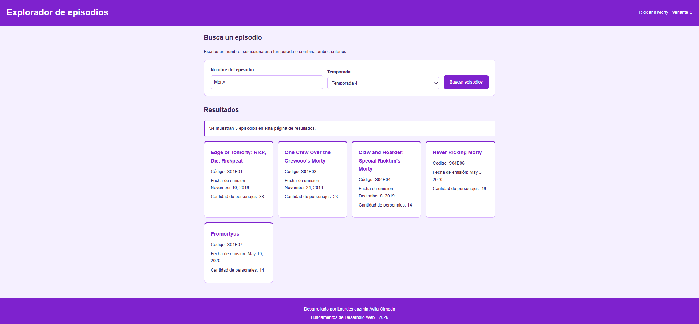

# Explorador de episodios de Rick and Morty

Aplicación web que permite consultar episodios por nombre y temporada.
Presenta los resultados en tarjetas y recuerda la última búsqueda.

## Autora
Lourdes Ávila

Asignatura: Fundamentos de Desarrollo Web · UCSA  
Variante del TP: C · Episodios  
Último dígito de cédula: 8

## Sitios publicados
- GitHub Pages: https://loujazz26.github.io/tp-avila-lourdes/
- Vercel: https://tp-avila-lourdes.vercel.app/

## Captura


## Funcionalidades
- Búsqueda por nombre del episodio.
- Filtro por temporada, desde S01 hasta S05.
- Combinación de nombre y temporada en una misma consulta.
- Tarjetas con nombre, código, fecha de emisión y cantidad de personajes.
- Mensajes de carga, sin resultados y errores de conexión.
- Guardado y recuperación de la última búsqueda con localStorage.
- Botón para limpiar los campos, los resultados y la búsqueda guardada.
- Diseño adaptable a computadoras y celulares.
- Número de versión visible en el pie de página.

La aplicación muestra la primera página de resultados de la API,
con hasta 20 episodios por consulta.

## Tecnologías
- HTML5 semántico.
- CSS3: variables, Flexbox, Grid y media queries.
- JavaScript ES6+.
- Fetch API con async/await.
- localStorage.
- Git y GitHub.
- GitHub Pages.
- Vercel

## API utilizada
Endpoint: https://rickandmortyapi.com/api/episode

Parámetros:
- `name`: nombre del episodio.
- `episode`: código de temporada, por ejemplo `S01`.

Ejemplo:
https://rickandmortyapi.com/api/episode?name=rick&episode=S01

## Estructura del proyecto
```text
tp-avila-lourdes/
├── .gitignore          # Archivos y carpetas excluidos de Git
├── index.html          # Estructura y formulario
├── README.md           # Documentación del proyecto
├── css/
│   └── estilos.css     # Diseño y adaptación a celulares
├── js/
│   └── app.js          # Consultas, tarjetas y persistencia
└── img/
    └── captura.png     # Captura de la aplicación
```

## Cómo ejecutarlo localmente
1. Tener Git instalado.
2. Clonar el repositorio:

```bash
git clone https://github.com/loujazz26/tp-avila-lourdes.git
```

3. Abrir la carpeta descargada.
4. Abrir `index.html` en el navegador o utilizar Live Server en VS Code.
5. Contar con conexión a internet para consultar la API.

No requiere instalar dependencias ni configurar claves de acceso.

## Desarrollo con ramas
La mejora del botón "Limpiar búsqueda" se desarrolló en la rama
`feature/limpiar-busqueda` y se integró a `main` mediante un pull request.

Pull request:
https://github.com/loujazz26/tp-avila-lourdes/pull/1

## Despliegue
### GitHub Pages
La publicación utiliza la rama `main` y la carpeta raíz `/ (root)`.
Los cambios enviados a esa rama activan la actualización del sitio.

### Vercel
El proyecto está conectado al repositorio de GitHub y utiliza
la rama `main` para producción.

Configuración: preset Other, directorio raíz ./ y sin comandos
de compilación personalizados.

Cada push a `main` activa automáticamente un nuevo despliegue.

### Comprobación de actualización
Se cambió la versión visible de 1.0 a 1.1 y se enviaron los
cambios a la rama main mediante git push.

GitHub Pages y Vercel actualizaron automáticamente la aplicación.
Se verificó que ambas direcciones públicas mostraran Versión 1.1.